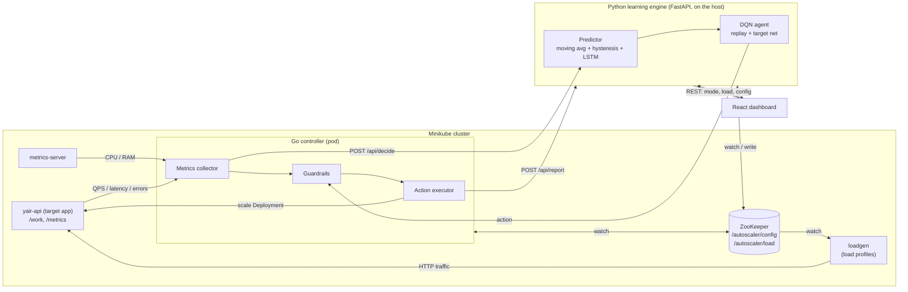
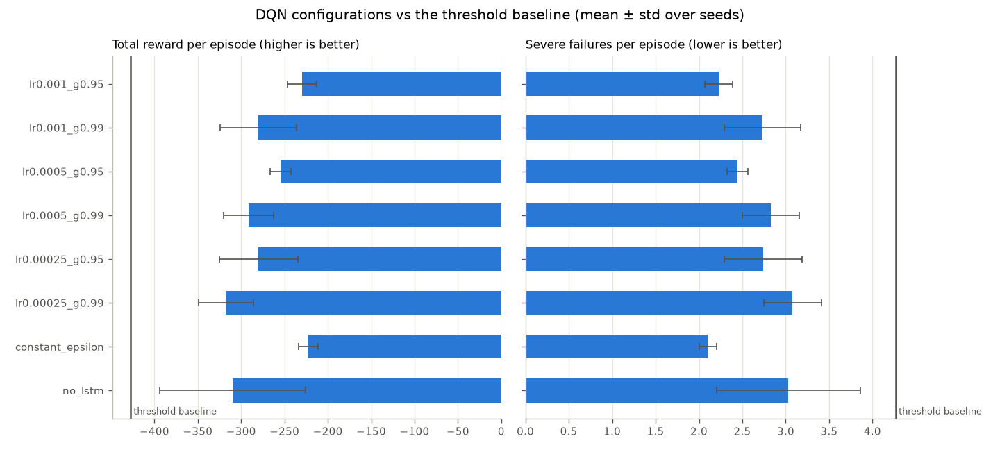
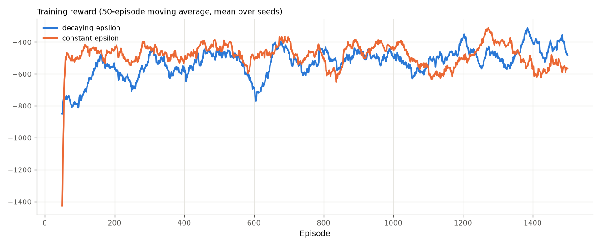
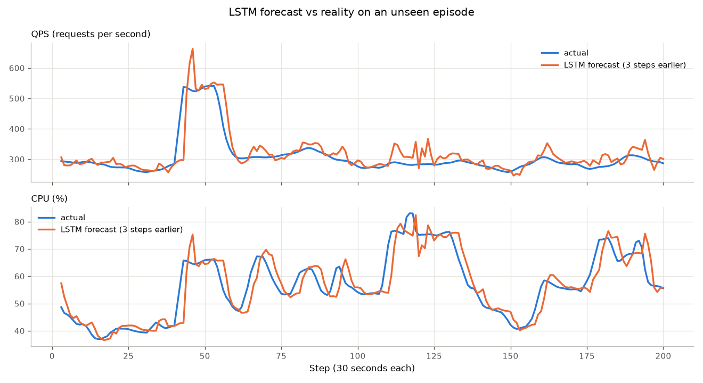
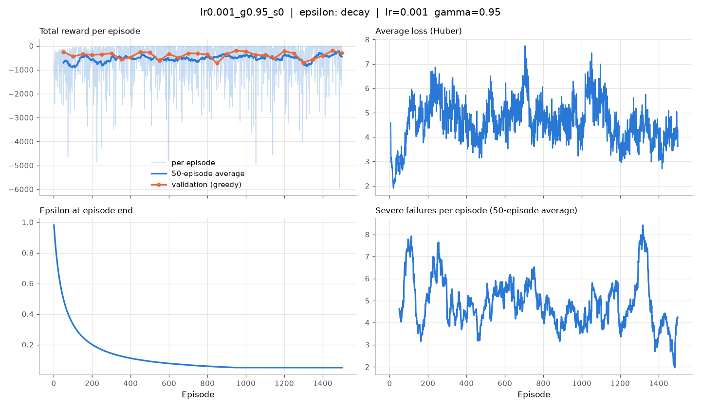
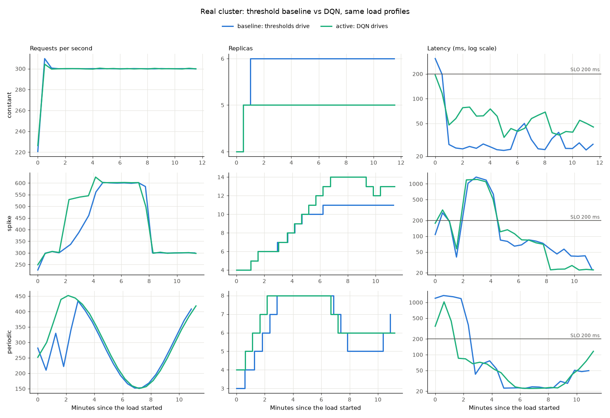
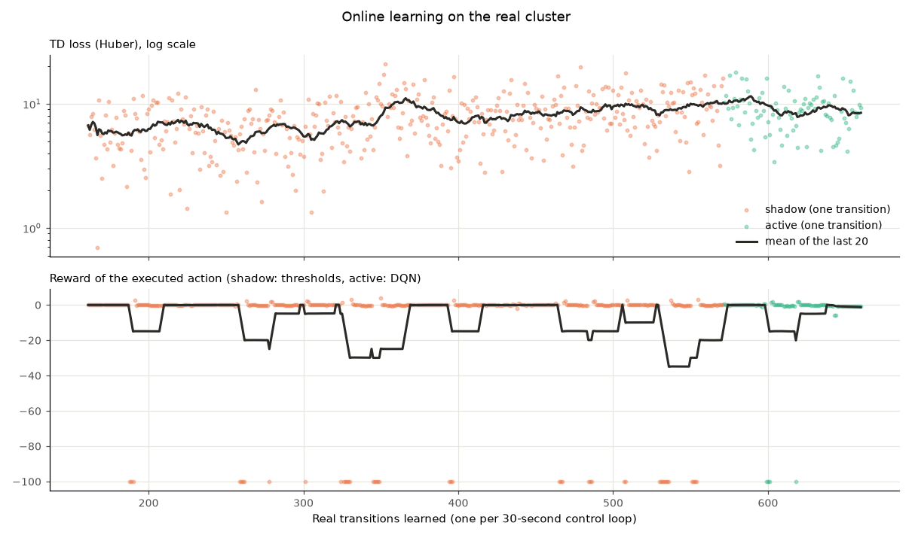
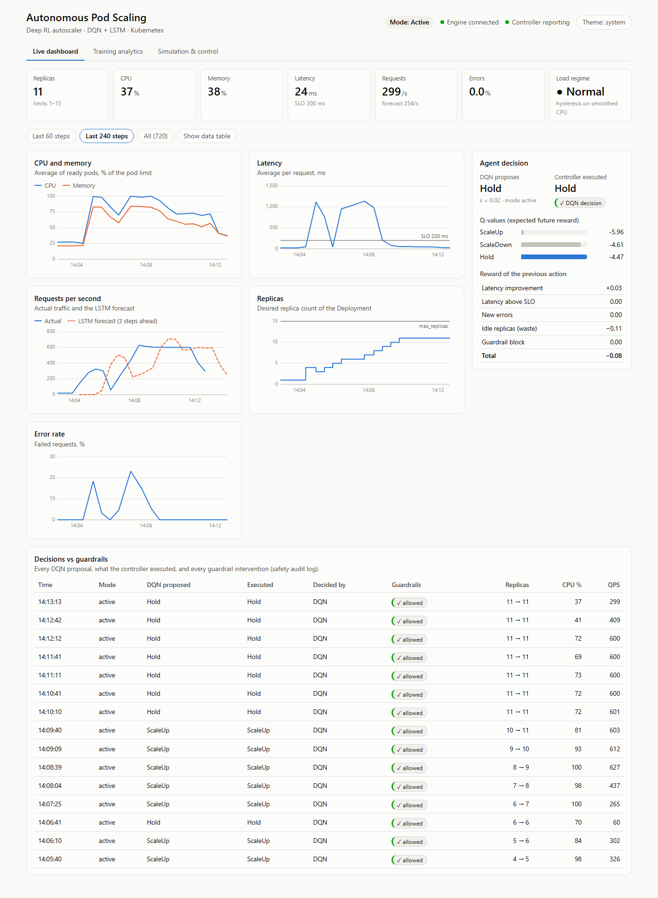
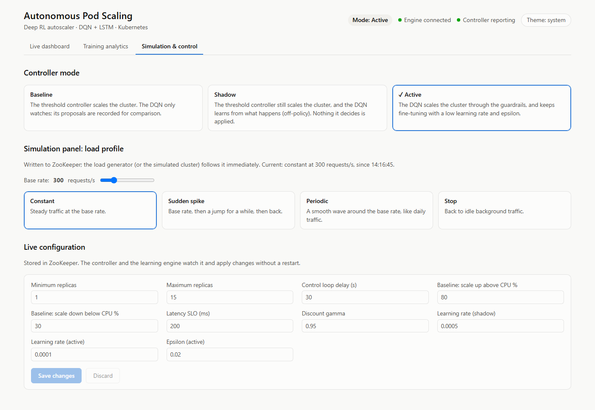

# Autonomous Kubernetes Pod Scaling Engine

A Deep Reinforcement Learning controller that replaces threshold-based autoscaling in Kubernetes.
Final project, practical engineering (Handasai) diploma, ORT Rehovot.

Static rules ("scale up at 80% CPU") flap around their thresholds, ignore latency and request
rate, and react only after the load has arrived. This system learns a scaling policy instead:
an LSTM forecasts the load a few minutes ahead, and a Deep Q-Network (DQN) chooses to scale up,
scale down or hold, balancing availability, performance and resource cost. Every decision passes
through hard guardrails before it touches the cluster.

---

## Architecture



| Component | Folder | Role |
|---|---|---|
| Learning engine | `back/python` | Predictor (smoothing, hysteresis, LSTM), DQN agent, reward, online learning, REST + WebSocket API |
| Cluster controller | `back/go/controller` | Collects metrics, applies guardrails, scales the Deployment, runs the modes. Runs as a pod with a least-privilege ServiceAccount |
| Target app | `back/go/targetapp` | The service being scaled: real CPU work, memory that grows with load, `/metrics` |
| Load generator | `back/go/loadgen` | Sends real traffic following the load profile in ZooKeeper |
| Dashboard | `front` | Live metrics, decisions vs guardrail blocks, training analytics, simulation panel |
| Kubernetes manifests | `back/k8s` | ZooKeeper, target app, load generator, controller (+ RBAC) |

The controller runs inside the cluster, like most Kubernetes controllers, and reaches the learning
engine on the host through `host.minikube.internal`. (It can also run on the host with
`go run ./controller`, using `~/.kube/config`; on Windows with Smart App Control enabled, the
compiled controller is blocked, which is why the cluster is the default.)

### One control loop (every 30 seconds)

1. **Collect.** The Go controller reads CPU and memory of the ready pods from metrics-server, and
   each pod's `/metrics` counters (through the Kubernetes API proxy), turning them into QPS,
   average latency and error rate. It also detects crashes (restarts, CrashLoopBackOff).
2. **Decide.** `POST /api/decide` sends the metrics. The Predictor smooths them, updates the
   hysteresis load regime and runs the LSTM forecast; together they form the DQN state. The outcome
   of the *previous* action is now known, so that transition is completed with its reward and
   learned from. The DQN returns its proposed action.
3. **Guardrails.** The action that the mode selects (DQN in active mode, threshold baseline
   otherwise) is checked: replica limits, the scale-down stabilization window, unknown actions.
   Blocked actions are never executed.
4. **Execute** the scale change, and **report** (`POST /api/report`) what was executed and what
   the guardrails did. The engine writes it to the audit log and streams it to the dashboard.

### Modes

| Mode | Who scales the cluster | Does the DQN learn? |
|---|---|---|
| `baseline` | Threshold controller (scale up above 80% CPU, down below 30%) | No; its proposals are only recorded for comparison |
| `shadow` | Threshold controller | Yes, off-policy, from the transitions the baseline produces |
| `active` | DQN, through the guardrails | Yes, fine-tuning with a lower learning rate and small epsilon |

In active mode, if the learning engine is unreachable, the controller falls back to the baseline,
so the service is never left unmanaged.

---

## Running it

### Option A: simulation only (no Kubernetes needed)

The mock environment stands in for the cluster: `simulate_controller.py` talks to the API exactly
like the Go controller does. Good for development and for a demo on any laptop.

```powershell
# once
cd back\python
python -m venv .venv
.venv\Scripts\python -m pip install torch==2.13.0 --index-url https://download.pytorch.org/whl/cpu
.venv\Scripts\python -m pip install -r requirements.txt
cd ..\..\front
npm install

# every time (opens three windows: API, simulated cluster, dashboard)
cd ..
powershell -ExecutionPolicy Bypass -File scripts\start-simulation.ps1
```

Open http://localhost:3000. In *Simulation & control*, pick a mode and trigger a load profile.

### Option B: the real system on Minikube

Requirements: Docker Desktop (running), [Minikube](https://minikube.sigs.k8s.io/), kubectl,
Node.js, and the Python environment from option A. Go is only needed to run the Go tests: the
Go programs are compiled inside Docker.

```powershell
winget install Kubernetes.minikube Kubernetes.kubectl

# Start Minikube (10 GB RAM, 8 CPUs), enable metrics-server, build the three Go images, deploy
# everything. Run it again after changing Go code: it rebuilds and restarts the pods.
powershell -ExecutionPolicy Bypass -File scripts\setup-minikube.ps1

# every time: ZooKeeper port-forward, API, controller log, dashboard (one window each).
# After a reboot it also starts Minikube again (everything stays deployed).
powershell -ExecutionPolicy Bypass -File scripts\start-system.ps1
```

The API server creates the ZooKeeper ZNodes with default values on first start; ZooKeeper keeps
them on a persistent volume, so they survive restarts. `python setup_config.py` resets them to the
defaults. Until the ZNodes exist, the controller waits for them. It logs every loop:
`kubectl logs -f deployment/autoscaler-controller`.

`minikube start` resets metrics-server to a 60-second resolution. Both scripts set it back to 15
seconds (`scripts\patch-metrics-server.ps1`), so the 30-second control loop never sees stale CPU
and memory.

---

## Training pipeline (sim-to-real)

All commands run from `back/python` with the virtual environment's Python
(`.venv\Scripts\python`). Without ZooKeeper, the scripts use the defaults from `setup_config.py`.

| Step | Command | Output |
|---|---|---|
| 1. Train the LSTM forecaster | `python train_lstm.py` | `models/lstm.pt`, `models/lstm_report.png` |
| 2. Pre-train the DQN in simulation | `python train_dqn.py --run-name my_run` | `runs/my_run/` |
| 3. Compare with the baseline | `python evaluate_dqn.py --run-name my_run` | table + `evaluation.json` |
| 4. Run the experiments | `python run_experiments.py` | `runs/experiments/summary.csv`, `summary.png` |
| 5. Deploy a model to the API | `python promote_model.py --run-name my_run` | `models/dqn.pt`, `models/model_info.json` |
| 6. Baseline on the cluster | `python run_cluster_stages.py --stage baseline` | `runs/cluster/baseline_<time>/` |
| 7. Shadow mode on the cluster | `python run_cluster_stages.py --stage shadow --qps-levels 200,300,400 --rounds 2` | learns from real transitions (about 4 hours) |
| 8. Active mode | `python run_cluster_stages.py --stage active` | fine-tuning only |
| 9. Compare the stages | `python run_cluster_stages.py --compare <run folders> --plot cmp.png` | table + figure |
| 10. Plot the online learning curve | `python run_cluster_stages.py --plot-learning learning.png` | TD loss and reward per real transition |
| 11. Retrain the LSTM on real data | `python train_lstm.py --from-csv data/metrics.csv` | forecaster fitted to the cluster |

Steps 6–8 need the cluster and the API server running (`scripts\start-system.ps1`). Each stage
runs every load profile from the same starting point (idle traffic, a fixed replica count) and
records every control loop. `--qps-levels` and `--rounds` repeat the profiles at several load
levels, so a long shadow run sees varied traffic. The script keeps Windows from sleeping while it
runs. The mode can also be switched by hand in the dashboard.

Online learning saves its own checkpoint (`data/online_dqn.pt`), replay buffer and learning curve
(`data/online_learning.csv`), and resumes from them after a restart. Delete them to restart from
the promoted model.

Only real cause and effect is learned:

- **Resets.** Between profiles the script switches the cluster to baseline mode (which does not
  learn) until the controller has decided once, then resets it. The transition that spans a reset
  (load switched off, replicas forced with kubectl) was caused by the harness, not by the agent's
  action, so it is never learned. Six such transitions from the first cluster runs were removed
  from the replay buffer.
- **Missing readings.** The controller skips a control loop when a reading is missing (metrics-server
  not ready yet, the first reading of the app's counters after a restart, no ready pods) instead
  of reporting zeros, like the Kubernetes HPA. A fake "0% CPU" would make the baseline scale down
  and teach the DQN something that never happened.

---

## Design

### Mock environment (`simulation/mock_env.py`)

Every metric has a cause, so the networks learn real cause and effect rather than noise:

- **Load**: QPS follows a load profile (constant, sudden spike, periodic) with momentum and a
  drifting trend, so it forms trends a forecaster can learn. Random sharp spikes (×1.5–2.2) and
  random pod crashes are the extreme events.
- **Utilization** = QPS / capacity of the ready pods → **CPU** rises linearly; **memory** follows
  utilization with inertia (released gradually); **latency** = service time + a memory term
  `3 ms · e^(k·(RAM − offset))` that grows exponentially with memory pressure + a queueing term
  that grows exponentially near the CPU limit; near saturation requests are rejected
  (**error rate**); CPU-starved pods fail their liveness probe and restart, and at 98% memory a
  pod is OOM-killed.
- **Calibrated against the real cluster** ([docs/calibration.md](docs/calibration.md)): the
  first version (latency driven by memory only) did not match the measured latency cliff, and the
  pre-trained agent proposed scaling *down* during a real overload.
- **Scaling has real costs**: a new pod is ready by the next control loop but runs cold (70%
  capacity) for one step, so late reactions hurt. Removing a pod fails part of its in-flight
  requests, and under memory pressure its load lands on the other pods (latency and error spike).
- The same guardrails as the Go controller, including the stabilization window.

### Reward (`core/reward.py`)

Computed from the state the cluster ended up in, never from the action label: scaling up earns
reward only if it actually helped.

| Term | Value |
|---|---|
| Severe failure: pod crash, latency ≥ 600 ms, or error rate ≥ 10% | −100 (replaces the terms below) |
| Latency improvement since the previous step | + (previous − current) / SLO |
| Latency above the SLO (200 ms) | − (latency − SLO) / SLO |
| New errors | − 0.5 per percentage point of increase |
| Waste: many replicas while CPU < 40% | − 2 · idle fraction · extra-replica fraction |
| Action blocked by a guardrail | − 5 (virtual penalty) |

### Predictor (`predictor/`)

- **Moving average** (3 readings) on CPU, memory, latency and QPS: one noisy reading does not
  trigger scaling. Error rate, replica count and crashes are kept exact.
- **Hysteresis** (dual thresholds) on smoothed CPU gives a load regime: it enters "high" above 75%
  but leaves only below 60% (and "low" below 25% / above 35%), so it does not flicker at a
  boundary the way a single threshold does.
- **LSTM** (32 hidden units) reads the last 12 readings and forecasts the change in CPU, memory,
  latency and QPS 3 steps (1.5 minutes) ahead. Predicting the *change* means the naive forecast
  ("the future equals now") is the zero baseline it must beat.

### DQN agent (`agents/dqn/`)

- **State (11 values)**: smoothed metrics (CPU, memory, latency, QPS, error rate, replicas), the 4
  LSTM forecasts, and the load regime, each scaled to about [0, 1].
- **Network**: 11 → 128 → 128 → 3 (ReLU), one Q-value per action.
- **Learning**: TD target `r + γ · Q_target(s', argmax_a' Q_online(s', a'))`, Huber loss,
  backpropagation with Adam and gradient clipping.
- **Experience replay**: 100,000 transitions, random batches of 64.
- **Target network** synced every 500 gradient steps, and **Double DQN** target (see decisions).
- **Epsilon**: `eps = max(eps_min, eps_0 / (k·t + 1))`, or constant (for comparison).
- **Model selection**: every 50 episodes the greedy policy runs on fixed validation episodes;
  `dqn.pt` keeps the best network, `dqn_last.pt` the last.

### Guardrails (`back/go/controller/guardrails.go`)

Every action is validated before execution: replicas stay within `[min_replicas, max_replicas]`;
no scale-down within 150 s of a scale-up (the Kubernetes HPA's *scale-down stabilization*,
against flapping; scaling up is never delayed); unknown actions are rejected. A blocked action
is not executed and the agent receives the virtual penalty.

### Configuration and persistence (no database)

- **ZooKeeper** `/autoscaler/config`: every tunable value (guardrails, mode, hyperparameters,
  reward weights, environment settings). Defaults in `back/python/setup_config.py`. The Go
  controller and the API server watch the ZNode and apply changes without a restart; the
  dashboard edits it. `/autoscaler/load` holds the active load profile, watched by the load
  generator. ZooKeeper stores its data on a PersistentVolumeClaim, so the configuration
  survives pod restarts and `minikube stop`.
- **Files** (`back/python/data/`): `metrics.csv` (time series, also LSTM training data),
  `audit.jsonl` (every decision vs every guardrail intervention), `online_dqn.pt` and
  `online_replay.pkl` (checkpoint and replay buffer). Trained models in `back/python/models/`.

---

## Results (simulation)

The mock environment was first calibrated against measurements of the real target app on Minikube
([docs/calibration.md](docs/calibration.md)): latency stays flat until the CPU limit and then
explodes, errors start at ~85% utilization, and CPU-starved pods get restarted. All numbers below
use the calibrated simulator.

Setup: every configuration was trained for 1,500 episodes (200 steps = 100 simulated minutes
each) with 3 random seeds, then evaluated greedily on 20 unseen test episodes per load profile.
The DQN and the threshold baseline face exactly the same loads. Values are per-episode averages
over the three profiles, mean ± standard deviation over seeds. Reproduce with
`python run_experiments.py`; raw numbers in [`docs/experiments_summary.csv`](docs/experiments_summary.csv).

| Configuration | Reward ↑ | Severe failures ↓ | SLO misses | Avg. replicas | Flaps ↓ |
|---|---|---|---|---|---|
| **lr 0.001, γ 0.95** (default) | **−230 ± 17** | **2.23 ± 0.16** | 1.5% | 11.3 | 1.5 |
| lr 0.001, γ 0.99 | −281 ± 44 | 2.73 ± 0.44 | 1.8% | 10.5 | 1.6 |
| lr 0.0005, γ 0.95 | −255 ± 12 | 2.44 ± 0.12 | 1.6% | 11.2 | 4.6 |
| lr 0.0005, γ 0.99 | −291 ± 29 | 2.83 ± 0.33 | 1.8% | 11.6 | 1.2 |
| lr 0.00025, γ 0.95 | −280 ± 45 | 2.74 ± 0.45 | 1.7% | 11.3 | 0.8 |
| lr 0.00025, γ 0.99 | −318 ± 31 | 3.08 ± 0.33 | 2.0% | 10.7 | 1.2 |
| Constant epsilon (0.1) | −222 ± 11 | 2.10 ± 0.10 | 1.4% | 12.3 | 1.9 |
| Naive forecast (no LSTM) | −310 ± 84 | 3.03 ± 0.83 | 1.8% | 11.3 | 1.1 |
| *Threshold baseline* | *−427* | *4.27* | *2.6%* | *9.9* | *0* |

(A flap is a scale action that reverses one taken within the previous 5 steps. A severe failure
is a control step with a crash, latency ≥ 600 ms or error rate ≥ 10%.)



What the experiments show:

- **Every DQN configuration beats the threshold baseline.** The default has 48% fewer severe
  failures (2.23 vs 4.27 per episode) with ~13% more replicas. The baseline scales up at 80% CPU,
  which on this app is right at the edge of the latency cliff; the DQN learned to keep a margin.
- **Learning rate × gamma**: γ = 0.95 beats γ = 0.99 at every learning rate. With 30-second
  steps, 0.95 looks ~10 minutes ahead, longer than a scaling decision takes to play out; 0.99
  adds far-future noise to the targets.
- **Decaying vs constant epsilon**: constant epsilon learns faster at first (it explores less),
  then the curves interleave. In evaluation they are within noise of each other (−222 ± 11 vs
  −230 ± 17); the constant-epsilon agents keep about one more replica.

  

- **LSTM vs naive forecast**: with the LSTM the agent has 26% fewer severe failures (2.23 vs 3.03)
  with the same number of replicas, and a much smaller spread between seeds. The forecaster itself
  beats the naive forecast ("the future equals now") by 24–40%:

  | Forecast 3 steps ahead (RMSE) | LSTM | Naive | Better by |
  |---|---|---|---|
  | CPU % | 4.5 | 5.9 | 24% |
  | Memory % | 2.5 | 4.1 | 40% |
  | Latency ms | 125 | 165 | 25% |
  | Requests/s | 60.5 | 79.1 | 24% |

  

- **What made training stable**: the first version (no Double DQN, last checkpoint kept, fast
  epsilon decay, no stabilization window) had a huge spread between seeds (−1,145 ± 880 for one
  configuration) and an agent that flapped up to 94 times per episode. Double DQN, validation-based
  model selection, slower epsilon decay and the stabilization guardrail fixed both. (Results on the
  uncalibrated simulator: [`docs/experiments_summary_v1_uncalibrated.csv`](docs/experiments_summary_v1_uncalibrated.csv).)

**The deployed model** (`models/dqn.pt`, seed chosen by validation reward, not by the test set):

| Load profile | Controller | Severe failures | SLO misses | Latency | Replicas |
|---|---|---|---|---|---|
| constant | DQN | **0.50** | 0.5% | 28 ms | 12.0 |
| | threshold | 2.55 | 1.6% | 48 ms | 9.0 |
| spike | DQN | **4.20** | 2.4% | 54 ms | 12.7 |
| | threshold | 6.55 | 3.7% | 75 ms | 11.0 |
| periodic | DQN | **1.55** | 1.1% | 35 ms | 11.7 |
| | threshold | 3.70 | 2.5% | 55 ms | 9.8 |



**Limits of these results.** Most remaining failures happen during the random sharp spikes (load
×1.5–2.2 within one step), which no forecaster can see coming and which one replica per step
cannot absorb. See the next section for the real cluster.

## Results (real cluster)

Setup: Minikube on the development machine. Target-app pods are limited to 200m CPU / 256 Mi,
between 1 and 15 replicas; the controller decides every 30 seconds. Each stage ran the three load
profiles for 12 minutes each (22–24 control loops), and every profile started from the same
point: idle traffic, 4 replicas, then 300 requests/s. *Spike*: ×2 (600 requests/s) from minute 2
to minute 8. *Periodic*: 150–450 requests/s, a 10-minute period.

| Stage | Who scales the cluster | Learning |
|---|---|---|
| baseline | threshold controller (up above 80% CPU, down below 30%) | none |
| shadow | the same threshold controller | the DQN learns from every real transition (off-policy) |
| active | the DQN, through the guardrails | fine-tuning (learning rate 0.0001, epsilon 0.02) |

The pipeline ran twice. **Run 1** (6 CPUs) fine-tuned on 160 real transitions. **Run 2**
(8 CPUs) continued from it with a 4-hour shadow stage: every profile at 200, 300 and 400
requests/s, twice (18 segments), for 410 more transitions, plus 69 in the active stage: 639 in
total. Before run 2, the harness was fixed so that only real cause and effect is learned (see
the training pipeline), and 6 earlier transitions that spanned a reset were removed.

### Run 2: after 639 real transitions

| Load profile | Controller | Severe failures ↓ | SLO misses ↓ | Avg. latency | Errors | Avg. replicas |
|---|---|---|---|---|---|---|
| constant | thresholds | 0 | 4.2% | 47 ms | 0% | 5.9 |
| | **DQN** | 0 | **0%** | 62 ms | 0% | **5.0** |
| spike | thresholds | 4 | 22.7% | 256 ms | 2.4% | 9.1 |
| | **DQN** | **3** | 22.7% | 254 ms | **1.9%** | 10.4 |
| periodic | thresholds | 4 | 22.7% | 274 ms | 3.7% | 6.4 |
| | **DQN** | **1** | **13.0%** | **121 ms** | **0.2%** | 6.7 |

(Severe failures are control loops with a crash, latency ≥ 600 ms or error rate ≥ 10%; SLO misses
are loops with latency above 200 ms. Raw data per control loop and the online learning curve:
[`docs/cluster_runs/run2_8cpu/`](docs/cluster_runs/run2_8cpu/).)



What changed from run 1 to run 2:

- **The over-provisioning is gone.** In run 1 the DQN kept 8.8 replicas on a constant load that
  6 can serve. After the longer fine-tuning it uses 5 – fewer than the thresholds – with no SLO
  miss. The safety margin it brought from simulation (where random sharp spikes happen) was
  corrected by real experience.
- **Periodic load is where it wins most.** One severe failure instead of 4, latency less than
  half, errors 0.2% instead of 3.7%, with 0.3 more replicas on average. It scales up while
  requests are rising, before CPU reaches the threshold controller's 80% trigger.
- **The spike is a draw.** Run 1's latency advantage in the spike (163 vs 252 ms) did not repeat.
  A sudden ×2 jump needs ~5 more replicas, and any controller that adds one per 30-second loop
  needs 2–3 minutes to get there; most failures happen in those minutes for both controllers.
  One replica per decision is a deliberate choice: larger steps would overshoot, and the
  stabilization window would keep the extra pods for 150 s (like the Kubernetes HPA, which also
  scales up fast but down slowly). Larger steps only when the LSTM forecasts a sharp rise is a
  possible extension.

Run 1 for reference (6 CPUs, 160 real transitions, raw data in
[`docs/cluster_runs/run1_6cpu/`](docs/cluster_runs/run1_6cpu/)):

| Load profile | Controller | Severe failures | SLO misses | Avg. latency | Errors | Avg. replicas |
|---|---|---|---|---|---|---|
| constant | thresholds / DQN | 0 / 0 | 0% / 0% | 45 / 28 ms | 0% / 0% | 5.8 / 8.8 |
| spike | thresholds / DQN | 3 / 2 | 22.7% / 17.4% | 252 / 163 ms | 2.5% / 0.5% | 9.0 / 10.7 |
| periodic | thresholds / DQN | 5 / 3 | 21.7% / 21.7% | 252 / 201 ms | 2.7% / 1.5% | 6.5 / 7.7 |

### Online learning curve



The TD loss did not fall during the shadow stage; it rose slowly from ~6 to ~9 and was flat in
the second half. The loss is dominated by the rare −100 transitions (severe failures), and the
replay buffer collected more of them as the run went on, so the average loss reflects what is in
the buffer more than how well the network predicts. The flat second half is the "stable against
real noise" criterion of the pipeline; the real test is the active stage, where behaviour
improved (above).

**Limits of these results.**

- One 12-minute run per profile and stage, so small differences are noise. In run 1, a second
  run of the same threshold policy (the shadow stage) differed by up to 1 severe failure, 5 points
  of SLO misses and 30 ms of average latency. The periodic-load improvement and the
  over-provisioning fix are larger than that; the spike results are within it.
- Shadow learning only sees the states the threshold controller leads to; what it never does
  (for example scaling up at 60% CPU) the DQN knows from simulation and from the active stage.
- Everything ran on one machine: the target pods, the load generator and Kubernetes share the
  same CPUs (6 in run 1, 8 in run 2).

### Dashboard

Screenshots from the real cluster, taken during a separate 10-minute run: the DQN in active mode
under the spike profile (the spike runs from 14:06 to 14:12).



The run shows the weak spot described above. It starts with 4 replicas, too few for the base
load, and the first decision was made while the measured traffic was still mostly idle (CPU
25%): the DQN removed a pod. The cluster was then overloaded for the first minutes (errors up to
23%), and CPU-starved pods were restarted by their liveness probe; while they restarted, the
measured traffic dropped to 60 requests/s and the DQN held for one loop instead of scaling up.
From then on it added a replica every loop up to 11 and held there (CPU ~70%, latency back
under 100 ms). The forecast line shows the LSTM's limit on a sudden jump: it cannot see the jump
coming, and once it has started it extrapolates it (overshooting to ~700 requests/s).



---

## API

The interactive reference is at http://localhost:8000/docs (FastAPI).

| Method | Path | Used by | Purpose |
|---|---|---|---|
| POST | `/api/decide` | Go controller | Metrics in, DQN decision out |
| POST | `/api/report` | Go controller | What was executed, guardrail result |
| WS | `/ws` | Dashboard | Snapshot, then every control step, config and load change |
| GET | `/api/status`, `/api/history`, `/api/audit`, `/api/online-training` | Dashboard | Live state |
| GET | `/api/runs`, `/api/runs/{name}`, `/api/experiments`, `/api/models` | Dashboard | Offline training results |
| GET/PUT | `/api/config` | Dashboard | Configuration (ZooKeeper) |
| POST | `/api/mode` | Dashboard | `baseline`, `shadow` or `active` |
| GET/POST | `/api/load` | Dashboard, simulator | Load profile |

## Tests

```powershell
cd back\python; .venv\Scripts\python -m pytest tests     # reward, mock env, predictor, DQN, API
cd back\go; go test ./...                                 # guardrails, baseline, rates, config, load profiles
cd front; npm test                                        # dashboard rendering from the WebSocket
```

## Design decisions beyond the proposal

| Decision | Why |
|---|---|
| PyTorch | An explicit training loop (forward, loss, backward) that is easy to follow and explain |
| Three actions (no Restart) | The core DQN design; restarts are Kubernetes' job (liveness probes) |
| Error rate in the state | The agent should see what it is penalized for |
| Target network + Double DQN | Standard DQN stabilizers; with the target network alone, results varied wildly between seeds |
| Validation-based model selection | DQN training is noisy; the last network is not always the best |
| Latency-above-SLO reward term | Rewarding only *changes* in latency would let a constantly high latency go unpunished |
| Scale-down stabilization guardrail | Without it the agent found that up-then-down costs nothing (a starting pod is removed first) and flapped |
| Latency and QPS from the app's `/metrics` | metrics-server provides only CPU and memory; no Prometheus needed |
| Shadow mode = baseline drives, DQN learns off-policy | "Nothing applied" must still keep the service scaled; Q-learning can learn from another policy's actions |
| Fallback to ZooKeeper-less defaults | Offline training and the simulation demo run without a cluster |

The first prototype (tabular Q-learning + safety bandit) is kept in `back/python/legacy/`.
